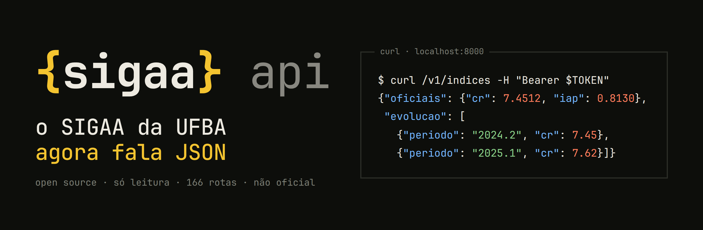
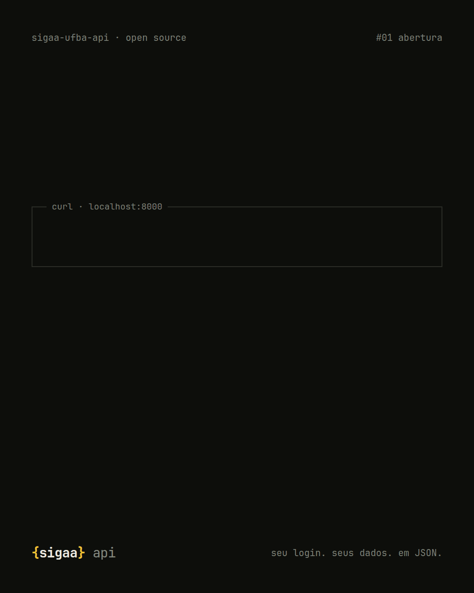
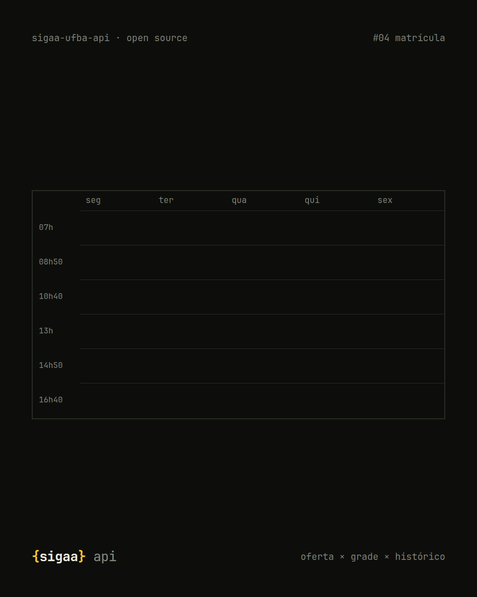

<p align="center">
  
</p>

<p align="center">
  
  
  
  
</p>

<p align="center"><b>O SIGAA nunca teve API. Agora tem.</b><br>
Seus dados acadêmicos da UFBA em JSON, prontos pro seu app, bot, automação ou trabalho de disciplina.</p>

---

## O muro

Quem estuda na UFBA e já tentou automatizar a vida acadêmica conhece a história. Você quer um painel do seu CR, um aviso
quando sai nota nova ou uma grade montada sem abrir dez abas. A ideia morre no mesmo lugar: **o SIGAA não tem API**.

Uma API é uma porta pela qual um programa conversa com outro: ele pede um dado e recebe pronto, sem ninguém clicar em
tela nenhuma. Sem ela, tudo o que está no SIGAA (histórico, notas, frequência, matrícula) só existe em telas antigas e
PDFs, e qualquer automação depende de alguém copiando à mão.

## A ponte

```
SIGAA  (telas, menus em JavaScript, PDFs)
  ↓
{sigaa} api  →  entra, navega, lê cada tela e cada PDF
  ↓
o seu projeto  →  recebe tudo organizado, em JSON, em qualquer linguagem
```

<p align="center">
  
  &nbsp;
  
</p>

## Tudo isso vira dado

| | o que você recebe |
|---|---|
| **histórico** | cada componente cursado, **CR e IAP** e a evolução semestre a semestre (o PDF vira JSON) |
| **semestre** | turmas, **notas, frequência, tarefas e provas** de todas as turmas |
| **matrícula** | o que dá pra pegar, pré-requisitos, **choque de horário**, sugestão de grade e previsão de oferta |
| **agenda** | grade horária em `.ics`, direto pro Google Agenda |
| **turma virtual** | notícias, aulas, arquivos, fóruns e participantes |
| **documentos** | comprovante de matrícula, declaração de vínculo, histórico em PDF |
| **público** | cursos, ementas, oferta de turmas, docentes, biblioteca, pesquisa e extensão, **sem login** |

São **166 rotas**. A lista completa está em [**docs/ENDPOINTS.md**](docs/ENDPOINTS.md).

## E com isso, você constrói

| | ideia | rotas |
|---|---|---|
| 01 | **bot de prazos**: toda segunda, as tarefas e provas da semana no grupo da turma | `/v1/tarefas` · `/v1/avaliacoes` |
| 02 | **painel do CR**: sua evolução e quanto você precisa tirar pra chegar onde quer | `/v1/indices` · `/v1/indices/simular` |
| 03 | **montador de grade**: escolhe as matérias e ele avisa choque e pré-requisito | `/v1/planejamento/simular` |
| 04 | **alerta de nota**: saiu nota, chegou aviso | `/v1/notas` |
| 05 | **sala livre agora**: onde estudar entre uma aula e outra | `/v1/salas-livres` |
| 06 | **pesquisa com dado real**: oferta histórica, ementas e cursos | `/v1/publico/componentes` · `/v1/consultas/turmas/historico` |

Pega a ideia e faz melhor. Se construir alguma coisa, abre uma issue contando: quero ver.

## Pra começar, 3 comandos

**1 · suba a API**

```bash
git clone https://github.com/caioalcarria/sigaa-ufba-api && cd sigaa-ufba-api
docker compose up -d
```

Sem Docker: `pip install -e ".[api]"` e depois `uvicorn api.main:app`.

**2 · entre** com o seu usuário e a sua senha do SIGAA

```bash
curl -X POST localhost:8000/v1/auth/login \
  -H 'Content-Type: application/json' \
  -d '{"usuario": "seu.login", "senha": "sua-senha", "lembrar": true}'
```

A resposta traz um `token`.

**3 · use** o token nas outras rotas

```bash
curl localhost:8000/v1/indices -H "Authorization: Bearer SEU_TOKEN"
```

```json
{
  "oficiais": { "cr": 7.45, "iap": 0.81 },
  "evolucao": [
    { "periodo": "2024.1", "cr_periodo": 6.9, "cr_acumulado": 6.9 },
    { "periodo": "2024.2", "cr_periodo": 8.1, "cr_acumulado": 7.45 }
  ]
}
```

Pra testar tudo pelo navegador, abra **http://localhost:8000/docs**: cada rota tem o botão *Try it out*.

## Bom saber

- **Rápida.** Um dado repetido sai do cache em menos de 1 milissegundo, e o "app" inteiro (6 consultas em paralelo) abre em
  cerca de 6 segundos. Pra forçar o dado mais novo, use `?fresco=true`.
- **Precisa.** CR e IAP são recalculados com a mesma regra da UFBA e batem com os oficiais até a 4ª casa decimal.
- **Gentil com a universidade.** Tem teto de conexões com o SIGAA, e os testes de carga rodam contra um SIGAA simulado,
  nunca contra o real.
- **Só lê.** Não matricula, não tranca e não envia nada.
- **Sua senha nunca é gravada.** Com `"lembrar": true`, ela fica só na memória do servidor, cifrada, pra API entrar de
  novo sozinha quando o SIGAA derrubar a sessão por inatividade.
- **Erros** vêm sempre no mesmo formato: `{"erro": {"codigo": "...", "mensagem": "..."}}`.

## Mais detalhes

| quero… | leia |
|---|---|
| ver todas as rotas | [docs/ENDPOINTS.md](docs/ENDPOINTS.md) |
| entender login, cache, erros e desempenho | [docs/GUIA.md](docs/GUIA.md) |
| usar como biblioteca Python ou em JavaScript | [examples/](examples) |
| saber como cada tela do SIGAA foi mapeada | [docs/mapeamento/](docs/mapeamento) |
| contribuir | [docs/CONTRATO.md](docs/CONTRATO.md) |
| saber o que a API garante de segurança e configurar produção | [docs/seguranca/](docs/seguranca/README.md) · reportar falha: [SECURITY.md](SECURITY.md) |

## Contribua

Achou um bug? Abre uma [issue](https://github.com/caioalcarria/sigaa-ufba-api/issues). Quer ajudar? Manda um PR: o
contrato de contribuição está em [docs/CONTRATO.md](docs/CONTRATO.md).

## Aviso

Este é um projeto **independente**, sem vínculo com a UFBA nem com a UFRN, que criou o SIGAA. Use só com as **suas**
credenciais. Se você hospedar a API pra outras pessoas, use HTTPS e deixe claro pra elas que a senha passa pelo seu
servidor.

---

<p align="center"><code>{sigaa} api</code> · licença <a href="LICENSE">MIT</a> · feito por estudante, pra estudante</p>
