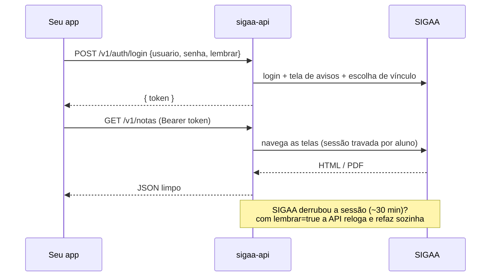

# Guia completo da SIGAA UFBA API

Tudo em detalhes: o que cada área devolve, login e sessões, desempenho, erros, privacidade e como funciona por dentro. Pra começar rápido, veja o [README](../README.md).


O SIGAA não tem API pública. Tudo que o aluno vê — histórico, notas, frequência, turmas, matrícula —
fica preso atrás de telas JSF, menus em JavaScript e PDFs. Este projeto entra **com o login do próprio
aluno**, navega o SIGAA por trás e devolve os dados **limpos, tipados e documentados**:

```bash
curl -s localhost:8000/v1/indices -H "Authorization: Bearer $TOKEN"
```
```json
{
  "oficiais": { "cr": 7.4512, "iap": 0.8123 },
  "calculo_confere_com_oficial": true,
  "evolucao": [
    { "periodo": "2024.1", "cr_periodo": 6.9, "cr_acumulado": 6.9,  "aprovados": 4, "reprovados": 1 },
    { "periodo": "2024.2", "cr_periodo": 8.1, "cr_acumulado": 7.45, "aprovados": 5, "reprovados": 0 }
  ]
}
```

> ⚠️ Projeto **independente**, sem vínculo com a UFBA, a STI/SUPAC ou a UFRN (autora do SIGAA).
> Use com as **suas** credenciais — ou com autorização explícita de quem é dono delas.

## ⚡ Começar em 1 minuto

```bash
git clone https://github.com/caioalcarria/sigaa-ufba-api && cd sigaa-ufba-api
docker compose up -d            # → http://localhost:8000/docs
```

<details>
<summary>Sem Docker</summary>

```bash
python -m venv .venv && . .venv/bin/activate
pip install -e ".[api]"
uvicorn api.main:app --reload
```
</details>

```bash
# 1. login → token
TOKEN=$(curl -s localhost:8000/v1/auth/login -H 'Content-Type: application/json' \
  -d '{"usuario":"seu.login","senha":"***","lembrar":true}' | jq -r .token)

# 2. use à vontade
curl -s localhost:8000/v1/pendencias            -H "Authorization: Bearer $TOKEN"
curl -s localhost:8000/v1/grade-horaria.ics     -H "Authorization: Bearer $TOKEN" > aulas.ics
curl -s localhost:8000/v1/historico/pdf         -H "Authorization: Bearer $TOKEN" > historico.pdf

# atalho pra script: Basic auth (a API cria e reaproveita a sessão). DESLIGADO por padrão:
# a senha viaja em toda requisição — religue só pra uso local com SIGAA_API_PERMITIR_BASIC=true
curl -s -u seu.login:*** localhost:8000/v1/notas
```

O Swagger em **`/docs`** descreve cada campo de cada resposta.

## 🧭 O que dá pra fazer

### 👤 Aluno e turmas
- Dados institucionais, dados pessoais, perfil, **foto** (`/v1/me?incluir_foto=true`) e integralização (`/v1/me`, `/v1/me/dados-pessoais`).
- **Todas as turmas** de todos os semestres, cada uma com um `turma_id` estável (`/v1/turmas`).
- **Grade horária** semanal com sala e choques de horário, e também em **`.ics`**, pra importar no Google Agenda.
- **Decodificador de horário**: `35N12` vira Terça e Quinta, 18:30–20:20, e o código original vem junto.

### 🏫 Turma virtual
- Notícias, aulas e tópicos, participantes (dos colegas, só nome e curso por padrão; `?dados_completos=true` traz o resto), plano de curso, arquivos (com download), referências, tarefas, questionários, enquetes, fórum.
- **Notas** por unidade (com peso de cada avaliação) e **frequência** aula a aula.
- Agregados de todas as turmas: `/v1/notas`, `/v1/frequencia`, `/v1/tarefas` (o que ainda não foi enviado) e `/v1/avaliacoes` (calendário de provas).

### 📜 Histórico e índices
- O **PDF do histórico vira JSON**: cada componente com nota, situação, natureza e docentes; equivalências; CH integralizada e pendente; extensão; obrigatórias pendentes.
- **CR e IAP** com as fórmulas exatas da UFBA (conferidas contra históricos reais) e **evolução do CR semestre a semestre**.
- **Simulador de CR**: `POST /v1/indices/simular` responde "e se eu tirar 8 em IHC?".

### 🗺️ Planejamento de matrícula
Junta histórico, grade do curso e oferta do semestre pra responder **"o que eu pego?"**:

| rota | responde |
|---|---|
| `GET /v1/grade-curricular` | sua grade, semestre a semestre, com cada componente marcado (aprovado/cursando/pendente, tentativas, por qual equivalência foi cumprido) |
| `GET /v1/planejamento/matricula` | o que está ofertado e você ainda precisa: **apto?** (e o que falta), **atrasado?**, **quantas outras destrava**, horários, vagas livres. Filtros: `natureza`, `so_aptos`, `turnos=N`, `sem_dias=sab`, `com_vagas` |
| `POST /v1/planejamento/simular` | você escolhe as turmas, ela aponta **choque de horário**, CH acima do máximo, pré-requisito faltando, turma lotada e como fica a integralização |
| `GET /v1/planejamento/sugestao` | uma grade **sem choque** montada automaticamente, priorizando obrigatórias atrasadas e as que destravam mais |
| `GET /v1/carga-horaria` | gestão de horas: obrigatória, optativa, complementar e extensão, com as atividades aceitas e rejeitadas |

### 🧾 Matrícula, documentos e vida acadêmica
- Turmas solicitadas e a situação de cada uma (deferida/indeferida/trancada), e a **sua posição no ranking** de cada turma.
- Comprovante de inscrição e declaração de vínculo, **estruturados ou no PDF original**.
- **Atividades autônomas** com o **parecer do coordenador** (por que foi rejeitada) e o comprovante enviado.
- Trancamentos (com motivo), suspensões e histórico de movimentações, aproveitamentos, diploma digital e avaliação institucional.
- Salas livres por prédio, dia e turno.

### 🌐 Público (sem login)
**55 rotas** em `/v1/publico/...`:
- Ensino: cursos, estruturas curriculares, componentes (ementa, pré-requisitos, equivalências), turmas ofertadas.
- Pessoas e unidades: docentes (perfil, produção, disciplinas), departamentos, centros.
- Biblioteca, pós-graduação, processos seletivos, pesquisa e extensão.

O calendário acadêmico fica em `/v1/calendario` e pede login.

➡️ **[Lista completa das 161 rotas](ENDPOINTS.md)**

## 🔐 Login e sessões



- **A senha nunca é gravada.** O token é opaco e o servidor guarda só o hash dele.
- Com **`lembrar: true`**, a senha fica **cifrada só na memória** (Fernet, chave criada no boot). Assim a API **reloga sozinha** quando o SIGAA derruba a sessão, e o cliente nem percebe.
  Sem `lembrar`, a resposta é `401 sessao_expirada` e o cliente faz login de novo.
- **Keep-alive**: sessões em uso recebem um toque periódico, pra não caírem no meio do uso.
- **Uma trava por aluno**: o SIGAA é *stateful*, então a navegação de cada sessão é serializada (alunos diferentes continuam em paralelo).
- Rotas de sessão: `GET /v1/auth/sessao`, `POST /v1/auth/renovar` e `DELETE /v1/auth/sessao` (faz logout de verdade no SIGAA).
- Há limite de tentativas de login por IP (IPv6 por bloco /64), de **falhas por usuário** (força bruta
  vinda de muitos IPs não chega à conta no SIGAA), de sessões por usuário e de sessões no total.
- Logout esquece tudo: o token, a senha cifrada do `lembrar`, as sessões do pool (logout no SIGAA), o
  cache do aluno e o pré-aquecimento em curso.
- Atrás de proxy reverso, diga ao uvicorn QUEM é o proxy: `FORWARDED_ALLOW_IPS=<ip do proxy>` (o
  padrão é só `127.0.0.1`). Nunca `*` com a API exposta direto: aí o cliente escolhe o próprio IP
  mandando `X-Forwarded-For` e fura o limite por IP.

<details>
<summary><b>Variáveis de ambiente</b></summary>

| variável | padrão | |
|---|---|---|
| `SIGAA_URL` | `https://sigaa.ufba.br` | outra instituição com SIGAA? troque aqui (funciona parcialmente) |
| `SIGAA_API_TOKEN_TTL_HORAS` | 12 | vida máxima do token |
| `SIGAA_API_TOKEN_OCIOSO_MIN` | 120 | token sem uso por esse tempo é descartado |
| `SIGAA_API_KEEPALIVE` · `_MIN` · `_JANELA_MIN` | true · 10 · 60 | keep-alive |
| `SIGAA_API_PERMITIR_LEMBRAR` | true | desliga o relogin automático |
| `SIGAA_API_PERMITIR_BASIC` | **false** | liga o Basic auth (`curl -u`) — a senha vai em toda requisição |
| `SIGAA_API_MAX_SESSOES` · `_POR_USUARIO` | 500 · 5 | |
| `SIGAA_API_MAX_LOGINS_POR_IP` | 20 / 10 min | anti força bruta (todas as tentativas, por IP) |
| `SIGAA_API_MAX_FALHAS_POR_USUARIO` · `_JANELA_FALHAS_USUARIO_MIN` | 5 · 15 | logins errados por conta (de qualquer IP) antes do `429`; 0 = desliga |
| `SIGAA_API_SEM_CORE_DUMP` | true | no boot: sem core dump e sem ptrace (`PR_SET_DUMPABLE=0`); false pra usar py-spy/gdb |
| `FORWARDED_ALLOW_IPS` (uvicorn) | `127.0.0.1,::1` | IP(s) do proxy reverso confiável pro `X-Forwarded-For` |
| `SIGAA_API_CORS` | vazio | origens de navegador liberadas (vírgula; `*` = qualquer). Vazio = nenhuma — ver [`seguranca/http.md`](seguranca/http.md) |
| `SIGAA_API_MAX_CORPO_BYTES` · `_MAX_URL_BYTES` | 65536 · 8192 | corpo (413) e caminho+query (414) máximos |
| `SIGAA_API_MAX_CABECALHOS_BYTES` · `_MAX_CABECALHOS` | 32768 · 100 | cabeçalhos da requisição (431) |
| `SIGAA_API_HSTS` | `auto` | HSTS só quando chegou por HTTPS (`true` = sempre, `false` = nunca) |
| `SIGAA_API_HOSTS` | vazio | hosts aceitos no `Host` (vazio = qualquer) |
| `SIGAA_API_DOCS` | true | `/docs`, `/redoc` e `/openapi.json` no ar |
| `SIGAA_API_FOTO_MAX_BYTES` | 2097152 | maior foto repassada (502 acima) |
| `SIGAA_API_CONC_POR_TOKEN` · `_POR_IP` · `_GLOBAL` | 6 · 8 · 128 | requisições em voo por token (429), por IP nas rotas públicas (429) e na API inteira (espera e depois 503); 0 = desliga |
| `SIGAA_API_CONC_ESPERA_S` | 20 | espera por vaga no teto global da API antes do `503` |
| `SIGAA_MAX_RESP_HTML_MB` · `SIGAA_MAX_RESP_PDF_MB` | 20 · 50 | maior resposta do SIGAA aceita, já descomprimida (`502 sigaa_resposta_grande`) |
| `SIGAA_API_STATUS_CACHE_S` | 10 | `/v1/status` reaproveita a sondagem do SIGAA por esse tempo (anti-amplificação) |
| `SIGAA_ESPERA_MAX_S` | 20 | quanto esperar por vaga no teto global (`SIGAA_API_MAX_CONCORRENCIA_SIGAA`) antes do `503 sigaa_ocupado` |
| `SIGAA_API_TIMEOUT_S` | 120 | prazo total de uma requisição (`504 tempo_esgotado`) |
| `SIGAA_PARSE_PROCESSOS` | núcleos-1 (1–8) | processos que fazem o parse de HTML/PDF fora do event loop (0 = desliga) |
| `SIGAA_API_GZIP_MIN_BYTES` | 2048 | gzip nas respostas maiores que isso (0 = desliga) |

Tudo fica em memória: reiniciar o servidor invalida os tokens. Rode **1 worker** (ou use *sticky sessions*):
o parse já usa os outros núcleos pelo pool de processos. Detalhes, números e o porquê em [`docs/servidor.md`](servidor.md).
</details>

## 🚀 Desempenho

Medido com a bancada do projeto (`bench/`): um **SIGAA simulado** com a mesma latência do real
(~450 ms por tela, ~3,5 s por PDF, ~3 s de login), pra testar carga sem tocar no SIGAA da UFBA.

| rota | 1ª chamada antes → agora | repetida antes → agora |
|---|--:|--:|
| `/v1/planejamento/matricula` | 14,3 s → **3,9 s** | 2 ms → **<1 ms** |
| `/v1/grade-curricular` | 10,9 s → **3,9 s** | 2 ms → **<1 ms** |
| `/v1/notas` (todas as turmas) | 9,2 s → **4,8 s** | 9,2 s → **<1 ms** |
| `/v1/frequencia` | 9,1 s → **4,9 s** | 9,1 s → **<1 ms** |
| `/v1/historico` | 4,7 s → **3,6 s** | 1 ms → **<1 ms** |
| `/v1/turmas` | 3,6 s → **3,0 s** | 3,5 s → **<1 ms** |
| `/v1/matricula` | 1,4 s → **0,6 s** | 1,4 s → **<1 ms** |
| públicas (cursos, componentes, estruturas…) | 0,2–1,3 s → **<1 ms** (cache compartilhado) | → **<1 ms** |

| carga (200 conexões simultâneas) | antes | agora |
|---|--:|--:|
| `/v1/notas`, 50 alunos | 4,2 req/s · p50 29,6 s | **30 req/s · p50 4,9 s** |
| `/v1/turmas`, 50 alunos | 12 req/s · p50 10,2 s | **67 req/s · p50 1,5 s** |
| rota pública | 11 req/s · p50 9 s | **16.200 req/s · p50 7 ms** |

**Como:**
- **pool de sessões SIGAA por aluno**: até 4 navegações do mesmo aluno em paralelo, com um transporte HTTP por sessão;
- **menos idas ao SIGAA**: reaproveita as 10 telas que o SIGAA guarda por sessão, usa GETs diretos e junta pedidos iguais;
- **cache em duas camadas**:
  - por aluno, com *stale-while-revalidate*;
  - compartilhado, pro que é público;
  - ETag/304, gzip, pré-aquecimento após o login e Redis opcional;
- **parse de HTML/PDF em processos separados** (o event loop nunca trava; PDF 12× mais rápido);
- **teto global de conexões ao SIGAA**, com 503 `sigaa_ocupado` + `Retry-After`, pra não derrubar a UFBA numa rajada.

Detalhes e todas as variáveis: [`docs/cache.md`](cache.md), [`docs/perf/sessoes.md`](perf/sessoes.md),
[`docs/servidor.md`](servidor.md), [`docs/bench.md`](bench.md).
`?fresco=true` (ou `Cache-Control: no-cache`) força dado novo; o header `X-Cache` diz se veio do cache.

## 🐍 Como biblioteca

```python
from sigaa import SigaaClient
from sigaa.services import academico, planejamento

async with SigaaClient() as sigaa:
    await sigaa.login(usuario, senha)

    hist = await sigaa.executar(academico.historico)
    print(hist.indices.cr, [c.codigo for c in hist.componentes if c.cursando])

    plano = await sigaa.executar(planejamento.planejamento)
    for c in plano.candidatos:
        if c.apto and c.natureza == "OBRIGATORIO":
            print(c.codigo, c.nome, [t.horario_codigo for t in c.turmas])
```

Exemplos prontos em [`examples/`](../examples): Python, shell e JavaScript.

## 🧯 Erros

Sempre no formato `{"erro": {"codigo": "...", "mensagem": "..."}}`.

| HTTP | código |
|---|---|
| 401 | `credenciais_invalidas` · `sessao_expirada` · `token_invalido` · `nao_autenticado` |
| 403 | `acesso_negado` |
| 404 | `nao_encontrado` |
| 422 | `requisicao_invalida` |
| 429 | `muitas_tentativas` |
| 502 | `sigaa_erro` · `navegacao_invalida` |
| 503 | `sigaa_indisponivel` · `sigaa_ocupado` (com `Retry-After`) |
| 504 | `tempo_esgotado` |

## 🛡️ Privacidade e boas maneiras

- **Só leitura.** Nenhuma rota matricula, tranca, solicita, avalia, posta ou envia nada.
- **Dados de terceiros ficam de fora.** O ranking de matrícula do SIGAA traz nome e matrícula de outros alunos; a API devolve só as contagens e a posição do próprio aluno.
- **CAPTCHA não é burlado.** O validador público de documentos e o diploma digital ficam de fora de propósito.
- **Gentil com o SIGAA.** As requisições são espaçadas, há cache curto por sessão e um teto de sessões anônimas nas rotas públicas.
- Vai hospedar pra outras pessoas? Você vai receber a senha delas: use **HTTPS**, não registre o corpo das requisições e avise os usuários (LGPD).

## 🔧 Como funciona por dentro

O SIGAA é JSF/MyFaces + Struts + RichFaces. Cada tela guarda estado no servidor (`javax.faces.ViewState`),
e a navegação só é aceita a partir de links que o próprio sistema gerou. O cliente (`sigaa/client.py`):

- atravessa a tela de avisos pós-login e a escolha de vínculo;
- dispara os itens do **menu JSCook** do portal e "clica" nos `h:commandLink` (`jsfcljs`) sem navegador;
- manda os formulários em **ISO-8859-1** (em UTF-8, qualquer busca com acento volta vazia);
- detecta sessão expirada, erro do sistema e navegação recusada, e reloga.

Os **parsers** são funções puras (HTML/PDF → modelo pydantic): procuram por rótulo, nunca por posição, e toleram as variações entre alunos.

```
sigaa/   biblioteca  →  client.py · models/ · parsers/ · services/ · util/horario.py
api/     servidor    →  main.py · sessions.py · deps.py · routes/
tests/   pytest dos parsers com fixtures ANONIMIZADAS
docs/    CONTRATO.md · ENDPOINTS.md · mapeamento/ (o passo a passo de cada tela)
```

O mapeamento de cada área está em [`docs/mapeamento/`](mapeamento): portal, turma virtual,
acadêmico, planejamento, consultas logadas e consultas públicas.

## 🤝 Contribuindo

Uma tela quebrou no seu caso? Isso é esperado: cada aluno vê o SIGAA de um jeito (outro curso, pós, EAD, transferência...).

1. Abra uma *issue* com o trecho do HTML **anonimizado** e o que veio em `linhas_nao_reconhecidas` ou `campos_extras`.
2. Ou mande o PR seguindo o [`docs/CONTRATO.md`](CONTRATO.md): parser puro + teste com fixture anonimizada + serviço + rota.

```bash
pip install -e ".[api,dev]" && pytest -q
python scripts/gerar_endpoints.py      # atualiza docs/ENDPOINTS.md
```

> **Nunca** suba HTML ou PDF real: eles têm CPF, RG e nomes de colegas.

## 🛣️ Próximos passos

- [ ] Ações (matrícula, envio de tarefa...), sempre com confirmação explícita
- [ ] Validador de documentos com CAPTCHA resolvido **por uma pessoa** (a imagem é repassada)
- [ ] Sessões persistentes (Redis) pra rodar com vários workers
- [ ] Testes com telas de pós-graduação, EAD e alunos com mais de um vínculo
- [ ] Outras instituições que usam SIGAA

## 📄 Licença

[MIT](../LICENSE). Feito por estudante, pra estudante. 💙
